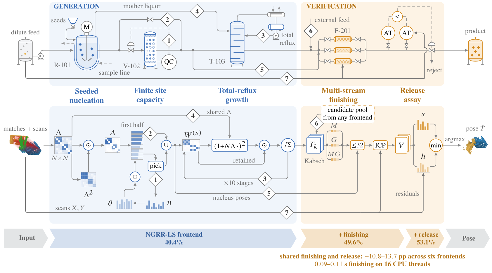

# Nucleate, Grow, Refine, Release: A Chemical-Process Framework for Robust Point Cloud Registration

Chengrui Xu†, Siyuan Jiang†, Xiaonan Wang\*
Tsinghua University · †Equal contribution · \*Corresponding author

[Project page](https://siyuanj.github.io/NGRR/) · [Paper (PDF)](docs/static/ngrr.pdf) · [Supplementary material (PDF)](docs/static/ngrr_supplementary.pdf) · arXiv (coming soon)

Point cloud registration can fail even when a frontend has generated useful
hypotheses. NGRR has two parts:

- a training-free **finishing and release** backend that works after any
  frontend: multi-stream finishing allocates at most 32 point-to-plane ICP
  refinements across distinct candidates, and release selects the refined pose
  with the best combination of geometric support and residual concentration;
- the **NGRR-LS** frontend, organized after chemical separation: motif
  nucleation, a finite (Langmuir-form) site capacity and retained-composition
  growth keep a correct, refinable candidate in the pool more often.

On all 1781 3DLoMatch+FPFH pairs the same backend improves six frontends by
10.8 to 13.7 percentage points, and NGRR-LS with the backend reaches 53.1%
recall at a median of 0.39 s per pair on CPU.

## This repository

| Path | Contents |
|---|---|
| `ngr/` | CPU reference implementation: generator, surface finishing and release |
| `tests/` | Self-contained tests; inputs are generated locally |
| `docs/method.md` | Equations, numerical conventions and coordinate scaling |
| `docs/` | Project page (GitHub Pages) |
| `docs/static/ngrr_supplementary.pdf` | Supplementary material as a separate PDF: method details with pseudocode and all settings, protocol, synthetic studies, stage diagnostics on all nine cohorts, per-scene results, cost and limitations |
| `paper/` | LaTeX source of the arXiv version and its build script |

The code is the reference implementation. It does not bundle datasets,
pretrained feature extractors, baseline adapters, compiled accelerated kernels
or the optional learned release, and it is not a one-command reproduction of
every experiment in the paper.

## Installation

Use Python 3.11:

    pip install .

For observed-surface registration (Open3D ICP):

    pip install ".[surface]"

## Quick check

This exact-motion example creates its input locally and needs no dataset or
trained weights:

    import numpy as np
    from ngr import register_with_surfaces

    p = np.random.default_rng(7).normal(size=(48, 3))
    angle = 0.4
    rotation = np.array([
        [np.cos(angle), -np.sin(angle), 0.0],
        [np.sin(angle),  np.cos(angle), 0.0],
        [0.0, 0.0, 1.0],
    ])
    translation = np.array([0.2, -0.1, 0.3])
    q = p @ rotation.T + translation
    pose = register_with_surfaces(p, q, p, q, inlier_radius=0.1, budget=16)
    np.testing.assert_allclose(pose["R"], rotation, atol=1e-6)
    np.testing.assert_allclose(pose["t"], translation, atol=1e-6)
    print("Registration check passed.")

Computation uses the CPU. NumPy/SciPy BLAS and PyTorch thread counts affect
runtime; set `OMP_NUM_THREADS`, `MKL_NUM_THREADS` and `OPENBLAS_NUM_THREADS`
before starting Python, and use `torch.set_num_threads` for a fixed CPU budget.

## Complete registration

    from ngr import register_with_surfaces

    pose = register_with_surfaces(
        p, q, source_points, target_points,
        inlier_radius=0.1, budget=32,
    )
    aligned = source_points @ pose["R"].T + pose["t"]
    attempts = pose["refinement_count"]

The matched arrays `p` and `q` have shape (N, 3), with N at least three.
Surface arrays contain the observed source and target points. All coordinates,
translations and the positive inlier radius use the same physical unit.

The returned `R` has shape (3, 3) and `t` has shape (3,); they map source into
target. Surface preparation keeps the first observation in each voxel of side
0.5 times the radius, preserving input order; each surface must retain at least
six observations. Each refinement attempt uses two ICP scales, with at most ten
iterations per scale.

The default budget is 32; a budget of 16 uses the corresponding nested queue
prefix. The budget caps attempts, and `refinement_count` reports actual use. If
no valid refined pose exists, registration raises `ValueError`.

## Finishing and release after another frontend

    from ngr import refine_candidates

    pose = refine_candidates(
        p, q, source_points, target_points,
        candidate_rotations, candidate_translations,
        native_pose={"R": native_rotation, "t": native_translation},
        inlier_radius=0.1, budget=32,
    )

Candidate rotations and translations have shapes (K, 3, 3) and (K, 3). The
native pose is the generator's own output, including its native refinement,
and is retained in the primary shortlist. Invalid raw rigid poses are
discarded; the native pose itself must be valid.

An optional auxiliary argument supplies a pair of rotation and translation
arrays for the additional refinement queue. All candidate translations use the
input coordinate unit. The complete interface automatically supplies direct
triple-nucleus fits as auxiliary proposals; pair nuclei supply grown poses
only.

## Correspondences only

    from ngr import register_correspondences

    pose = register_correspondences(p, q, inlier_radius=0.04)

This interface uses the capacity-aware generator and its native residual
readout. The radius scales the compatibility kernel and correspondence refits
together. Seeding requires admissible geometric support; if no nondegenerate
nucleus exists, registration raises `ValueError`. Exactly three mutually
consistent matches can leave the triple ranking empty because its score
requires additional graph support.

## Implementation

- `ngr/_core.py`: compatibility, capacity-aware motif selection and phase growth.
- `ngr/_rigid.py`: weighted rigid fits and correspondence refitting.
- `ngr/_surface.py`: candidate allocation, ICP, surface evidence and release.
- `ngr/registration.py`: unit-aware registration and candidate-pool interfaces.

## Tests

    pip install ".[surface,test]"
    python -m pytest

Tests generate their inputs locally. Without the surface extra the Open3D tests
are skipped.

## Paper source

`paper/src` is the LaTeX source of the arXiv version (main paper followed by the
supplementary material). `paper/build.sh` compiles it with pdflatex and bibtex
and writes `paper/ngrr_arxiv.pdf` and the upload archive
`paper/ngrr_arxiv_source.tar.gz`, which carries `main.bbl` because arXiv does
not run BibTeX. `paper/site_table.py` prints the project page's results table
from the paper's table source.

## Citation

    @misc{xu2026ngrr,
      title  = {Nucleate, Grow, Refine, Release: A Chemical-Process Framework for Robust Point Cloud Registration},
      author = {Xu, Chengrui and Jiang, Siyuan and Wang, Xiaonan},
      year   = {2026},
      note   = {arXiv preprint}
    }

## License

A license for the code has not been chosen yet. The project page in `docs/` is
built on the [Academic Project Page Template](https://github.com/eliahuhorwitz/Academic-project-page-template)
and, like it, is licensed under [CC BY-SA 4.0](http://creativecommons.org/licenses/by-sa/4.0/).
